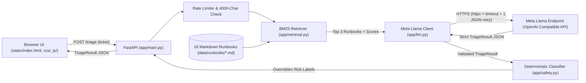

# RunbookPilot

**Live Demo:** [https://runbookpilot.rhasan.online](https://runbookpilot.rhasan.online)  
**Built for the Meta Global AI Developer Hackathon** — Powered by **Meta Muse Spark 1.3** (`muse-spark-1.3`) and **Meta Llama**.

RunbookPilot is a grounded, multimodal IT incident triage and runbook automation workbench for Windows Managed Service Providers (MSPs). An IT support engineer selects a pending ticket/RMM alert (or attaches a Windows error screenshot), and RunbookPilot retrieves matching Markdown runbooks via BM25L, synthesizes a grounded diagnosis and remediation plan using **Meta Muse Spark 1.3**, deterministically classifies every suggested PowerShell command by risk (`read_only` vs `needs_approval`), and provides closed-loop RMM diagnostic re-triage, PSA ticket writeback, and autonomous runbook generation for uncovered incidents.

**RunbookPilot NEVER executes any PowerShell or system command.** All commands are displayed as plain text or staged in a read-only RMM simulation queue for human review.

---

## Key Meta AI Hackathon Capabilities

1. **Multimodal Error Screenshot Triage (`muse-spark-1.3` Native Vision)**:
   - Technicians can attach or generate sample Windows error dialog screenshots (`data:image/png;base64,...`) alongside tickets in `POST /triage`.
   - `app/llm.py` dispatches OpenAI-compatible multimodal `image_url` blocks + visual context to `muse-spark-1.3` to extract hex error codes (`0x800423f4`, `0x80070005`), Event IDs, and failing service names directly from screenshots.
2. **Closed-Loop Agentic RMM Re-Triage**:
   - After queuing a `read_only` PowerShell diagnostic check via the RMM integration (`POST /integrations/rmm/dispatch`), technicians can click **"Re-run triage with this output"** to feed the diagnostic telemetry (`rmm_diagnostic_output`) back into `POST /triage` so `muse-spark-1.3` narrows the root cause and remediation steps.
3. **Autonomous Runbook Synthesis & Hot-Indexing (`POST /runbooks/draft` & `POST /runbooks/index`)**:
   - When an incident falls outside the 18-runbook corpus (`escalate=true`), technicians can click **"Draft a runbook"** to synthesize a structured Markdown runbook (`RunbookDraftResult`) with every PowerShell command deterministically classified via `app/safety.py`, then click **"Add this runbook and re-run triage"** to add it to the active BM25L index (`18 -> 19 runbooks`) and resolve the ticket immediately.
4. **Interactive Safety Lab and Benchmark (`/#safety`, `/#benchmark`)**:
   - **Deterministic PowerShell Safety Sandbox (`POST /safety/inspect`)**: Test safe and adversarial PowerShell strings (`Get-ADUser`, `;` pipeline injection, `-EncodedCommand`, `$()` subexpressions, `Format-Volume`) with stage-by-stage explanations.
   - **Live 20-Ticket BM25 & Safety Benchmark Scorecard (`GET /eval/summary`)**: Real-time verification of 100% top-3 retrieval hit rate (`17/17` covered tickets) and `0` mislabeled `needs_approval` commands across the entire runbook corpus.
5. **Meta Model Telemetry & Reasoning Mode Control (`Standard` vs `Deep`)**:
   - Toggle between `standard` and `deep` multi-hop reasoning modes and inspect `X-Meta-Model`, `X-Reasoning-Mode`, `X-BM25-Scores`, and `X-Safety-Overrides` telemetry headers directly in the UI.

---

## Architecture



---

## User interface

A static frontend with no build step: `static/index.html`, `static/css/*.css` and ES modules in `static/js/`. It follows the system light or dark theme and has a theme toggle.

| Route | View |
| :--- | :--- |
| `/#triage` (default) | Ticket box, samples, screenshot attach, Standard/Deep mode, queue, and the result |
| `/#runbooks` | Search and read the 18 runbooks (static copy in `static/runbooks/`, kept equal to `data/runbooks/`) |
| `/#safety` | Safety lab: check how the safety rules label a PowerShell command |
| `/#benchmark` | Benchmark: runbook search and command safety scorecard |
| `/#integrations` | The 12 PSA and RMM connectors, staged |

**Triage flow.** Paste a ticket, pick a sample, attach a screenshot, or select **Run demo** on the empty state (it loads the AD lockout sample and analyzes it). Press **Analyze ticket** or Ctrl+Enter. The result shows, in order: a verdict strip (covered, needs approval, or escalate, with confidence and runbook count), the likely cause, steps you can tick (ticks stay in your browser), commands grouped by risk with a Copy button, source runbooks you can open and read, an escalation panel, collapsed Details (request ID, model, scores, raw labels), and a staged ticket note bar.

**Labels.** Risk always shows as text: **Read-only**, **Needs approval**, **Escalate**. Queue items and RMM telemetry carry a **Sample data** label. Connectors, RMM actions and ticket notes carry **Staged, not live** or **Staged, not sent to a live PSA**. The UI never runs a command.

**Errors.** Rate limit, timeout, model error, bad input and no connection each show the cause, a next step and **Try again**. Raw detail sits in a collapsed Technical details.

---

## Setup on Windows 11 (PowerShell)

Run all commands in **Windows PowerShell** from the repository root:

```powershell
# 1. Create a Python 3.11 virtual environment
py -3.11 -m venv .venv

# 2. Allow activation in the current PowerShell process (if needed) and activate
Set-ExecutionPolicy -Scope Process -ExecutionPolicy Bypass
.\.venv\Scripts\Activate.ps1

# 3. Install dependencies
python -m pip install --upgrade pip
python -m pip install -r requirements.txt

# 4. Create your local .env from .env.example and fill in your Meta Llama endpoint details
Copy-Item .env.example .env
notepad .env

# 5. Run the unit test suite
python -m pytest -v

# 6. Start the FastAPI server
python -m uvicorn app.main:app --host 127.0.0.1 --port 8000
```

Open `http://127.0.0.1:8000` in your browser to use the UI (it opens on `/#triage`), or check `http://127.0.0.1:8000/health` for index status.

---

## Environment Variables

All LLM access is centralized in `app/llm.py`. Secrets are never hard-coded or logged.

| Variable | Required | Default | Description |
| :--- | :---: | :---: | :--- |
| `LLM_BASE_URL` | Yes | — | OpenAI-compatible base URL serving a Meta model (e.g., `https://api.meta.ai/v1` for Muse Spark, or `https://api.together.xyz/v1` for Llama). |
| `LLM_MODEL` | Yes | — | Meta model identifier (e.g., `muse-spark-1.3` or `meta-llama/Llama-3.3-70B-Instruct-Turbo`). Non-Meta models are rejected. |
| `LLM_API_KEY` | Yes | — | Bearer API key for the Meta model endpoint. |
| `LLM_TIMEOUT_SECONDS` | No | `55.0` | Upstream HTTP timeout in seconds for each model request (sized under Vercel's 60s function limit). |
| `RATE_LIMIT_REQUESTS` | No | `15` | Maximum `POST /triage` requests allowed per client IP per window. |
| `RATE_LIMIT_WINDOW_SECONDS` | No | `60` | Sliding rate-limit window duration in seconds. |

---

## Deploying to Vercel (PowerShell)

The repository includes `vercel.json` (bundling `data/**` and `static/**` into the FastAPI serverless function with `maxDuration: 60`).

1. Configure `LLM_BASE_URL`, `LLM_MODEL`, and `LLM_API_KEY` in your Vercel Project Settings → **Environment Variables**.
2. Deploy from Windows PowerShell via GitHub import or the Vercel CLI:
   ```powershell
   vercel --prod
   ```

---

## Running the Evaluation Suite

`data/tickets_eval.json` contains **20 synthetic tickets** (17 covered across the MSP runbooks and 3 out-of-scope tickets expecting `escalate=true`).

With `.env` configured and `.venv` activated in PowerShell, run:

```powershell
python scripts\eval.py
```

`scripts/eval.py` prints per-ticket status (logging `request_id` only, never ticket text) and reports four aggregate metrics:
1. **Retrieval hit rate (top-3)** — fraction of covered tickets where `expected_runbook_id` appears in the BM25 top 3.
2. **Cause match rate** — fraction of covered tickets whose `likely_cause` matches `expected_cause_keywords`.
3. **Escalate accuracy** — agreement with `expected_escalate` across all 20 tickets.
4. **`needs_approval` commands wrongly labeled `read_only`** — must be `0` (exits with status code `1` if non-zero).

---

## Ticketing/PSA & RMM Integrations (Standby Mode)

`app/integrations.py` and the **Integrations** view (`/#integrations`) provide a staged connector registry for **12 popular MSP platforms**:

- **Ticketing & PSA (6)**: ConnectWise PSA, Datto Autotask PSA, HaloPSA, ServiceNow ITSM, Jira Service Management, and Freshservice.
- **RMM Platforms (6)**: NinjaOne RMM, Datto RMM, ConnectWise Automate, N-able N-central, Atera RMM, and SyncroMSP.

All connectors operate in **staged/standby mode** (`live_sync_active=false`, `remote_execution_allowed=false`):
- `GET /integrations` & `GET /integrations/{provider_id}`: List connector specifications, capabilities, webhook paths, and masked configuration state (`"********"` for saved secrets).
- `PUT /integrations/{provider_id}`: Validate and stage endpoint URLs, credentials, and sync mode (`draft_internal_note`, `webhook_auto_triage`, or `manual_pull`).
- `POST /integrations/{provider_id}/test`: Run a staged dry-run validation of required fields and URL schemas without making external network calls.
- `DELETE /integrations/{provider_id}`: Clear stored credentials and reset the connector to `not_configured`.
- `POST /integrations/webhooks/{provider_id}`: Standby webhook receiver that returns HTTP `202 Accepted` (`mode="staged_standby"`), enqueues incoming ticket/alert payloads into the pending queue, and logs `request_id` + `provider_id` only (never webhook payload content).
- `GET /integrations/queue`: Returns pending and triaged PSA tickets and RMM alerts (each enriched with read-only `RMMDeviceTelemetry` endpoint context; supports `?staged_only=true` filtering).
- `POST /integrations/tickets/{ticket_id}/writeback`: Formats and records a staged PSA internal triage note (`action="internal_note"`) or Tier 3 escalation (`action="escalate"`) and updates the queue item status (`triaged` / `escalated`).
- `POST /integrations/rmm/dispatch` & `GET /integrations/rmm/jobs`: Deterministically classifies submitted commands via `app/safety.py` and queues a staged simulation job (`executed_on_host=false`). Commands classified as `needs_approval` require `approved_by_technician=true` and a non-empty `approval_note`.

---

## Safety Design

1. **Zero Command Execution**: Neither the backend nor the UI executes PowerShell commands (`subprocess`, `os.system`, and shell invocations are completely absent from application code).
2. **Deterministic Risk Override (`app/safety.py`)**: Model-predicted command risk labels are **always overwritten** deterministically before any response leaves `POST /triage`:
   - **`read_only` allowlist**: Single-line commands (or pipelines where *every* stage is `read_only`) using `Get-*`, `Test-*`, `Select-*`, `Measure-*`, or safe `Format-*` output cmdlets, plus `ipconfig` (read-only flags only), `nslookup`, `ping`, and `hostname`.
   - **Explicit rejections & default-deny (`needs_approval`)**: Blocks `Format-Volume`/`Format-Disk`/`Format-Partition`, pipes into `Invoke-Expression` (`iex`), `;` / `&&` / `||` / newline chaining, `$()` subexpressions, `()` parenthetical sub-commands, `{}` scriptblocks, backtick obfuscation, `&` call operators, `>`/`<` file redirection, local/UNC script paths, `-EncodedCommand`/`-enc`/`FromBase64String`, mutating switches (`-Repair`, `-OutFile`), and mutating verbs (`Remove-*`, `Set-*`, `Stop-*`, `Restart-*`, `Disable-*`, `Clear-*`, etc.). Everything not proven `read_only` defaults to `needs_approval`.
3. **Strict Runbook Grounding & Validation**:
   - The system prompt instructs the Meta Llama model to answer **only** from `<RUNBOOKS>`, treat `<TICKET>` as untrusted data, and set `escalate=true` when runbooks do not cover the ticket.
   - Output is validated against Pydantic v2 (`TriageResult`) and checked to ensure `matched_runbooks` contains only retrieved runbook IDs, retrying **once** on malformed or invalid JSON.
4. **UI Warnings & XSS Prevention**:
   - The UI shows an "Escalate to Tier 3" panel when `escalate=true`, and a "Changes the system. Needs approval." warning above every `needs_approval` command. Every command block says "Not run by RunbookPilot."
   - All dynamic text is rendered exclusively via `textContent` (never `innerHTML`).
5. **Privacy-Preserving Logging**:
   - Middleware logs generated `request_id`, HTTP method, path, status code, and latency — never ticket content or `LLM_API_KEY`.

---

## Known Limits

- **Lexical Retrieval Only**: BM25 matches exact and normalized tokens/tags rather than semantic embeddings; heavily paraphrased tickets with zero keyword overlap may miss retrieval and trigger escalation.
- **Conservative Static Command Parser**: Because `app/safety.py` fails closed without invoking PowerShell's runtime AST, benign read-only commands that use scriptblocks (`Where-Object { ... }`) or parenthetical date expressions (`(Get-Date).AddDays(-1)`) are conservatively classified as `needs_approval`.
- **Single-Process In-Memory State**: The BM25 index and sliding-window rate limiter live in process memory; editing runbook files requires restarting the server, and multi-worker deployments enforce rate limits per worker process.
- **External Meta Model Dependency**: Live triage and full `scripts/eval.py` runs require network connectivity to a configured Meta Llama endpoint.
